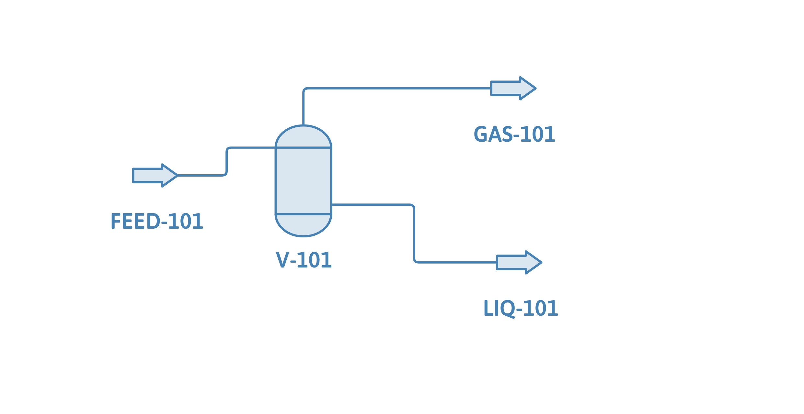
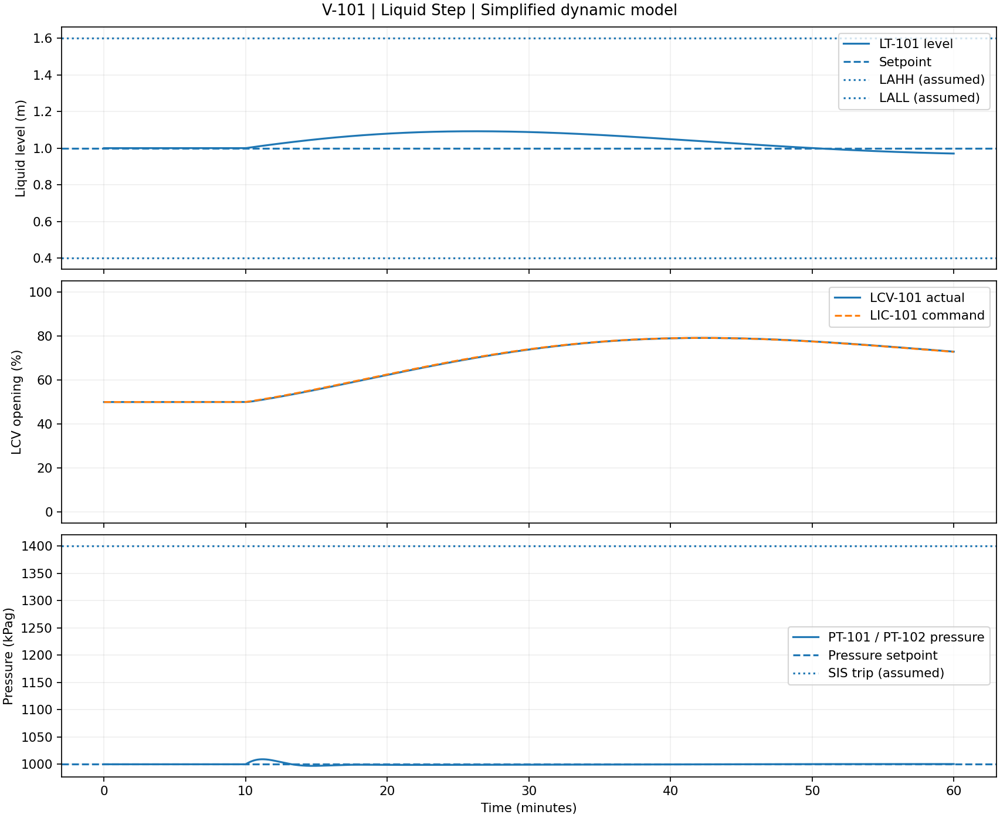
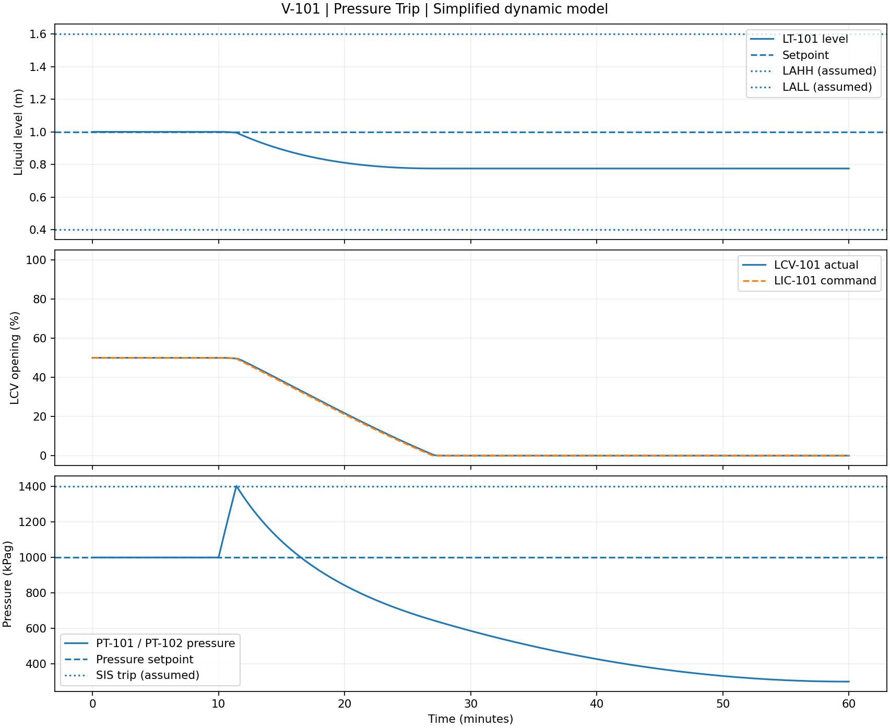

# Oil & Gas Separator — Instrumentation and Control Design

**Educational engineering portfolio project**: a conceptual two-phase oil-and-gas separator design, a DWSIM steady-state flowsheet, an AutoCAD P&ID, an instrument I/O register, and a simplified Python dynamic-control simulation.



## At a glance

| Item | Design reference |
|---|---|
| Separator | V-101, two-phase, horizontal for Python model |
| Nominal dimensions | 2.0 m internal diameter × 6.0 m tangent-to-tangent |
| Normal liquid level | 1.0 m |
| Pressure / temperature | 1,000 kPag / 35 °C |
| Nominal liquid / gas feeds | 20 m³/h / 1,000 Sm³/h |
| Normal control | LT-101 → LIC-101 → LCV-101; PT-101 → PIC-101 → PCV-101 |
| Temperature | TE-101 → TT-101 → DCS monitoring |
| Conceptual shutdown | PT-102 → PAHH-101 SIS function → SDV-101 |

The DWSIM file is a **steady-state flash/separator simulation**, not a coupled dynamic plant model. The Python program is an **independent educational dynamic model** and does not numerically import DWSIM results. Its simplified cylinder geometry excludes vessel heads. See [Engineering limitations](#engineering-limitations).

## Project files

| Path | Contents |
|---|---|
| [`design/01_Design_Basis.xlsx`](design/01_Design_Basis.xlsx) | Original design basis (as supplied) |
| [`design/04_Separator_PID.dwg`](design/04_Separator_PID.dwg) | Editable AutoCAD drawing |
| [`design/04_Separator_PID.pdf`](design/04_Separator_PID.pdf) | Landscape-oriented P&ID preview (rotated for reading) |
| [`dwsim/03_Seperator_Simulation.dwxmz`](dwsim/03_Seperator_Simulation.dwxmz) | Editable DWSIM steady-state case |
| [`dwsim/03_Seperator_Simulation.png`](dwsim/03_Seperator_Simulation.png) | Flowsheet preview |
| [`docs/V101_Instrument_IO_List_RevA.xlsx`](docs/V101_Instrument_IO_List_RevA.xlsx) | Preliminary instrument I/O register |
| [`src/separator_sim.py`](src/separator_sim.py) | Python level / pressure / alarm simulation |
| [`tests/test_simulator.py`](tests/test_simulator.py) | Automated consistency checks |
| [`results/`](results/) | Seven scenario plots and CSV exports |

### P&ID preview

[Open the P&ID PDF](design/04_Separator_PID.pdf). The PDF was rotated for easier landscape viewing; the DWG remains unchanged. The original PDF is preserved as `04_Separator_PID_original.pdf`.

## Run on Windows (VS Code + Git Bash)

**Open the repository root folder** (`oil-gas-separator-control-system`) in VS Code. In the Git Bash terminal, run these commands from that root folder:

```bash
py -m venv .venv
./.venv/Scripts/python.exe -m pip install -r requirements.txt
./.venv/Scripts/python.exe src/separator_sim.py --scenario all
./.venv/Scripts/python.exe tests/test_simulator.py
```

If `py` is unavailable, use `python -m venv .venv`. For macOS or Linux, use `python3 -m venv .venv`, `./.venv/bin/python -m pip install -r requirements.txt`, and `./.venv/bin/python ...`.

To run one scenario:

```bash
./.venv/Scripts/python.exe src/separator_sim.py --scenario liquid_step
```

Outputs are saved into **`results/`**, regardless of which working directory you launch Python from, unless `--output` overrides this. You may specify another output folder:

```bash
./.venv/Scripts/python.exe src/separator_sim.py --scenario pressure_trip --output my_results
```

If Python and the required packages are installed globally, replace `./.venv/Scripts/python.exe` with `python`. The project needs only NumPy and Matplotlib; `python-control` is not used because the discrete PI controllers are implemented directly.

## Simulation scenarios

| Scenario | Test |
|---|---|
| `baseline` | Nominal steady operation |
| `liquid_step` | +40% inlet liquid flow at 600 s |
| `gas_step` | +30% inlet gas flow |
| `high_level` | 3× liquid inlet rate |
| `low_level` | Low inlet and stuck-open LCV |
| `stuck_lcv` | Liquid outlet valve stuck at 20% |
| `pressure_trip` | High gas inflow with restricted PCV, triggering conceptual shutdown |

### Example results





Data tables are available in each scenario's corresponding `.csv`, and `results/summary.csv` summarizes the runs. These are computed outputs of the idealized model, not plant commissioning data.

## How the controller works

Liquid volume is the horizontal-cylinder segment volume. The program numerically integrates `dV/dt = Q_in - Q_out`, and computes pressure with an isothermal ideal-gas inventory balance. The discrete direct-acting PI loops open their respective outlet valves when level or pressure rises above setpoint. Output limits and conditional integration anti-windup are implemented; valve responses use first-order lag and simplified pressure-drop relationships.

- **LIC-101** acts on **LCV-101** for liquid level regulation.
- **PIC-101** acts on **PCV-101** for pressure regulation.
- **LAHH-101/LALL-101** are modelled as DCS alarms, not separate safety shutdowns.
- **PT-102 / PAHH-101 / SDV-101** are a conceptual latched pressure trip with an assumed threshold.
- **PSV-101** is drawn but **not sized or dynamically simulated**.
- Temperature is fixed at 35 °C; no thermal transient model is included.

## Engineering limitations

This is a **conceptual educational simulation only**, not a certified separator design, validated safety instrumented system, or pressure-relief study. The gas model is ideal and isothermal; dynamic phase equilibrium, vessel heads, instrument noise, sensor failure diagnostics, real valve Cv/actuator sizing, gas entrainment, gas-liquid mass transfer, and overflow hydraulics are omitted. Volume is capped at 99% of nominal cylindrical capacity as a numerical constraint, so the high-level scenario is not a physically valid overflow calculation.

**Illustrative assumptions rather than datasheet-validated settings** include: outlet backpressure (300 kPag), LAHH (1.6 m), LALL (0.4 m), pressure trip (1,400 kPag), controller gains, valve capacities, time constants, and injected failure magnitudes. Do not use these for plant operation or safety decisions. The P&ID and design basis may use inconsistent PLC/DCS terminology; the implementation is Python only.

See [`docs/VALIDATION_AND_OPEN_ITEMS.md`](docs/VALIDATION_AND_OPEN_ITEMS.md) for test evidence and outstanding work.

## Reproducibility and provenance

The engineering files are provided as project artifacts. The Python simulator code was generated with AI assistance and must be reviewed, understood, and independently developed further before representing it as wholly original work. Running the included tests establishes selected software consistency properties, **not** validation against DWSIM or physical data.
